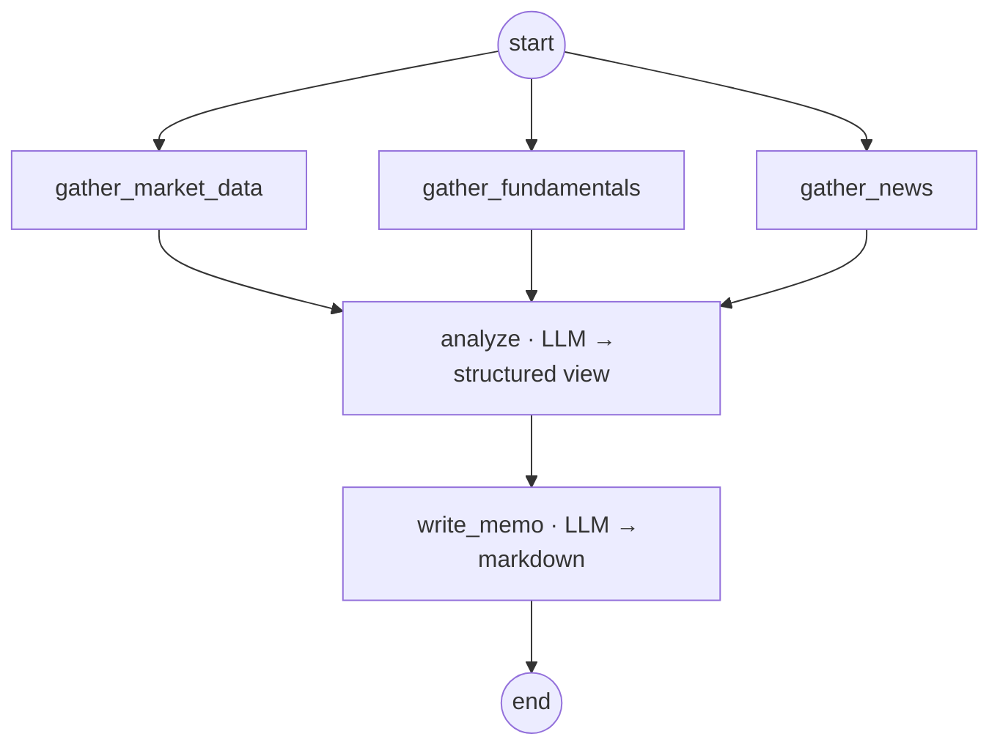

# Finance Agentic Workflow

> A documented, extensible **LangGraph** framework for building finance AI workflows — starting with an autonomous **equity‑research assistant** that gathers market data, fundamentals, and news, reasons over them with Claude, and drafts an investment memo.

This repository is a **portfolio project**. Its goal is to demonstrate how I design, document, and ship agentic AI workflows: clean graph orchestration, a pluggable tool/data layer with real‑API‑plus‑offline‑fallback, structured LLM outputs, and a CLI you can run end‑to‑end with **zero setup** (no API key, no internet — it falls back to bundled sample data and a deterministic analyst).

---

## Why this exists

Most "AI agent" demos are a single prompt in a loop. Real workflows need:

- **Deterministic orchestration** you can read, test, and reason about — here, a LangGraph state graph with explicit nodes and a fan‑out/fan‑in shape.
- **A clean tool/data boundary** — data providers that try a live source, then fall back to reproducible sample data, so the workflow always runs.
- **Structured, typed LLM output** — the analysis step returns a validated Pydantic object, not free text.
- **Graceful degradation** — with no `ANTHROPIC_API_KEY`, the graph still completes using a deterministic, rule‑based analyst, so a reviewer can run it immediately.
- **Extensibility** — new finance workflows register themselves and appear in the CLI. The equity‑research workflow is the first of four planned (see [docs/workflows.md](docs/workflows.md)).

---

## The first workflow: Equity Research Assistant



1. **Gather** market data, fundamentals, and recent news *in parallel* (LangGraph superstep fan‑out).
2. **Analyze** — Claude reads the gathered context and emits a *structured* view: thesis, strengths, risks, valuation view, recommendation, and confidence (validated with Pydantic).
3. **Write memo** — Claude drafts a readable Markdown investment memo from the structured analysis and the underlying data.

Every data point is tagged `live` or `sample` so the output is always honest about its provenance.

---

## Quickstart

> Requires Python 3.10+. Examples use Windows PowerShell; the same commands work on macOS/Linux with `python3` and `source .venv/bin/activate`.

```powershell
# 1. Create and activate a virtual environment
py -3.12 -m venv .venv
.\.venv\Scripts\Activate.ps1

# 2. Install (with live-data extras)
pip install -e ".[live,dev]"

# 3. Generate the bundled sample data (reproducible, seeded)
python scripts/generate_samples.py

# 4. Run the equity-research workflow — works offline, no API key needed
finwf run equity-research --ticker AAPL --offline
```

To use Claude for real analysis, set your key first:

```powershell
$env:ANTHROPIC_API_KEY = "sk-ant-..."
finwf run equity-research --ticker MSFT
```

List available workflows:

```powershell
finwf list
```

---

## How the LLM is wired

The reasoning steps call **Claude Opus 4.8** (`claude-opus-4-8`) through `langchain-anthropic`:

```python
from langchain_anthropic import ChatAnthropic

llm = ChatAnthropic(model="claude-opus-4-8", max_tokens=4096)
structured = llm.with_structured_output(AnalysisResult)  # validated Pydantic out
```

The model id is configurable via `FINWF_MODEL`. See [docs/architecture.md](docs/architecture.md) for the full design and [.env.example](.env.example) for all settings.

---

## Project layout

```
finance-agentic-workflow/
├── src/finance_workflow/
│   ├── config.py          # settings (env-driven)
│   ├── llm.py             # ChatAnthropic factory + availability check
│   ├── registry.py        # workflow registry (name -> Workflow)
│   ├── cli.py             # `finwf` command-line entry point
│   ├── tools/             # data providers (live + sample fallback) and @tool wrappers
│   └── workflows/
│       ├── base.py        # Workflow ABC that every workflow implements
│       └── equity_research/   # the first concrete workflow (LangGraph)
├── scripts/generate_samples.py   # reproducible sample-data generator
├── examples/run_equity_research.py
├── tests/
└── docs/
```

---

## Documentation

- [docs/architecture.md](docs/architecture.md) — design, data flow, graph anatomy, design decisions.
- [docs/workflows.md](docs/workflows.md) — the four planned workflows and their status.
- [docs/adding-a-workflow.md](docs/adding-a-workflow.md) — step‑by‑step guide to add your own.

## Status

| Workflow | Status |
|---|---|
| Equity research assistant | ✅ Implemented |
| Financial document analysis | 🚧 Planned |
| Portfolio & risk analytics | 🚧 Planned |
| Market & news monitor | 🚧 Planned |

The framework (registry, tool layer, base classes, CLI) is built so the remaining three plug in without changing the core.

## License

MIT — see [LICENSE](LICENSE).
