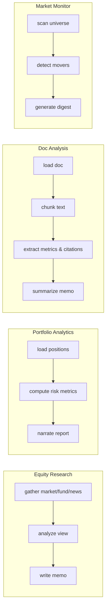

# Finance Agentic Workflow

> A documented, extensible **LangGraph** framework for building finance AI workflows — spanning autonomous **equity research**, **portfolio risk analytics**, **financial document analysis**, and a **market/news monitor**.

This repository is a **portfolio project**. Its goal is to demonstrate how I design, document, and ship agentic AI workflows: clean graph orchestration, a pluggable tool/data layer with real‑API‑plus‑offline‑fallback, structured LLM outputs, and a CLI you can run end‑to‑end with **zero setup** (no API key, no internet — it falls back to bundled sample data and a deterministic analyst).

---

## Why this exists

Most "AI agent" demos are a single prompt in a loop. Real workflows need:

- **Deterministic orchestration** you can read, test, and reason about — here, LangGraph state graphs with explicit nodes, fan-out/fan-in shapes, and sequential pipelines.
- **A clean tool/data boundary** — data providers that try a live source, then fall back to reproducible sample data, so the workflow always runs.
- **Structured, typed LLM output** — analysis steps return validated Pydantic objects, not free text.
- **Graceful degradation** — with no `ANTHROPIC_API_KEY`, every graph still completes using deterministic, rule-based reasoning engines and templates, so a reviewer can run it immediately.
- **Extensibility** — new finance workflows register themselves and appear in the CLI. All 4 core workflows are implemented today (see [docs/workflows.md](docs/workflows.md)).

---

## The Four Workflows



1. **Equity Research Assistant (`equity-research`)**: Gathers market metrics, fundamentals, and recent news in parallel; reasons over valuation and competitive moat; outputs a structured investment memo.
2. **Portfolio & Risk Analytics (`portfolio`)**: Prices holdings CSV or inline positions; computes trailing returns, volatility, max drawdown, sector exposure, weighted beta, and concentration (HHI); narrating portfolio risk.
3. **Financial Document Analysis (`doc-analysis`)**: Ingests 10-K filings, earnings releases, or PDFs; chunks with section headers; extracts key figures (Revenue, Net Income, Margins, Debt, EPS, Cash Flow) and risk disclosures with source citations.
4. **Market & News Watchlist Monitor (`monitor`)**: Scans a universe of tickers; computes daily change and volatility outliers; aggregates headline catalysts; generates a structured market digest.

Every data point is tagged `live`, `file`, or `sample` so the output is always honest about its provenance.

---

## Quickstart

> Requires Python 3.10+. Examples use Windows PowerShell; the same commands work on macOS/Linux with `python3` and `source .venv/bin/activate`.

```powershell
# 1. Create and activate a virtual environment
py -3.12 -m venv .venv
.\.venv\Scripts\Activate.ps1

# 2. Install (with live-data extras)
pip install -e ".[live,dev]"

# 3. Generate the bundled sample data (reproducible, seeded)
python scripts/generate_samples.py

# 4. Run any workflow — works offline, no API key needed
finwf run equity-research --ticker AAPL --offline
finwf run portfolio --holdings examples/sample_portfolio.csv --offline
finwf run doc-analysis --ticker AAPL --offline
finwf run monitor --tickers AAPL,MSFT,NVDA --offline
```

To use Claude for real analysis, set your key first:

```powershell
$env:ANTHROPIC_API_KEY = "sk-ant-..."
finwf run equity-research --ticker MSFT
finwf run doc-analysis --file examples/sample_earnings_release.txt
finwf run monitor --tickers AAPL,MSFT,NVDA
```

List available workflows:

```powershell
finwf list
```

---

## How the LLM is wired

The reasoning steps are **model-agnostic**: they go through LangChain's
`init_chat_model`, so you can run them on any supported provider — Anthropic,
OpenAI, Google, Groq, Mistral, a local Ollama, and more. The default is
**Claude Opus 4.8** (`claude-opus-4-8`):

```python
from langchain.chat_models import init_chat_model

# provider inferred from the model name (claude-* -> anthropic, gpt-* -> openai, ...)
llm = init_chat_model("claude-opus-4-8", max_tokens=4096)
structured = llm.with_structured_output(DocumentAnalysisResult)  # validated Pydantic out
```

Pick a model with `FINWF_MODEL` (and `FINWF_MODEL_PROVIDER` when the name is
ambiguous), then install that provider's extra:

```powershell
pip install -e ".[openai]"
$env:OPENAI_API_KEY = "sk-..."
$env:FINWF_MODEL = "gpt-4o"
finwf run equity-research --ticker MSFT
```

Available provider extras: `openai`, `google`, `groq`, `mistral`, `ollama`
(Anthropic works out of the box). See [docs/architecture.md](docs/architecture.md)
for the full design and [.env.example](.env.example) for all settings.

---

## Project layout

```
finance-agentic-workflow/
├── src/finance_workflow/
│   ├── config.py          # settings (env-driven)
│   ├── llm.py             # ChatAnthropic factory + availability check
│   ├── registry.py        # workflow registry (name -> Workflow)
│   ├── cli.py             # `finwf` command-line entry point
│   ├── tools/             # data providers (MarketData, Fundamentals, News, Portfolio, Document, Monitor)
│   └── workflows/
│       ├── base.py            # Workflow ABC that every workflow implements
│       ├── equity_research/   # parallel gather → analyze → memo
│       ├── portfolio/         # load → compute metrics → narrate
│       ├── doc_analysis/      # load → chunk → extract with citations → summarize
│       └── monitor/           # scan universe → detect movers → digest
├── scripts/generate_samples.py   # reproducible sample-data generator
├── examples/
│   ├── run_equity_research.py
│   ├── run_portfolio.py
│   ├── run_doc_analysis.py
│   └── run_monitor.py
├── tests/
│   ├── test_equity_research.py
│   ├── test_portfolio.py
│   ├── test_doc_analysis.py
│   ├── test_monitor.py
│   ├── test_tools.py
│   └── test_registry.py
└── docs/
```

---

## Documentation

- [docs/architecture.md](docs/architecture.md) — design, data flow, graph anatomy, design decisions.
- [docs/workflows.md](docs/workflows.md) — the four workflows and their capabilities.
- [docs/adding-a-workflow.md](docs/adding-a-workflow.md) — step‑by‑step guide to add your own.

## Status

| Workflow | Status | Description |
|---|---|---|
| Equity research assistant (`equity-research`) | ✅ Implemented | Parallel multi-source gather, structured analysis, and memo drafting. |
| Portfolio & risk analytics (`portfolio`) | ✅ Implemented | Position weighting, risk metrics, concentration, and narration. |
| Financial document analysis (`doc-analysis`) | ✅ Implemented | Chunking, key financial metric & risk extraction with source citations. |
| Market & news monitor (`monitor`) | ✅ Implemented | Universe scanning, mover detection, headline feed, and watchlist digest. |

## License

MIT — see [LICENSE](LICENSE).
